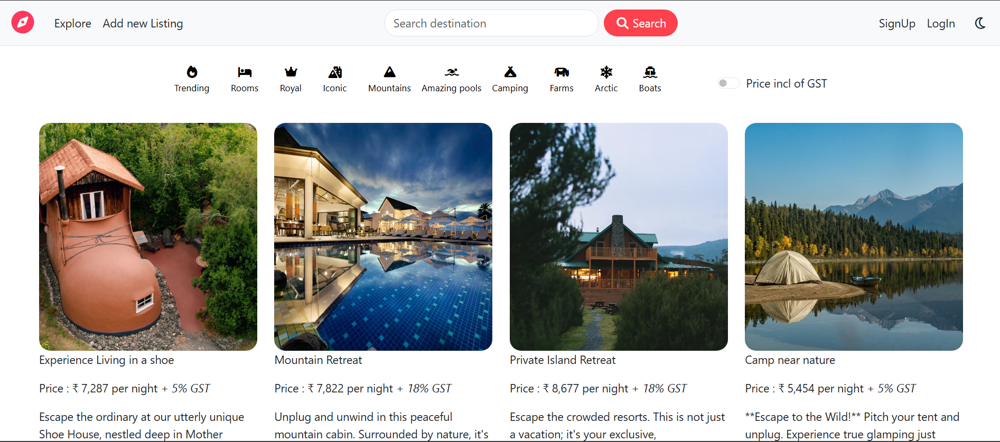
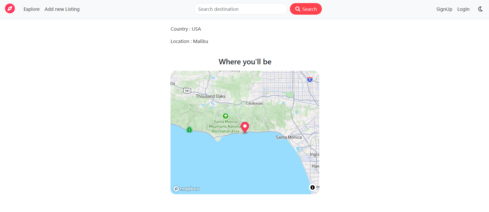

# Wanderlust

Wanderlust is a full-stack accommodation listing web application inspired by Airbnb, where users can browse stays, publish listings with cloud-hosted media, inspect locations on interactive maps, and share community reviews.

## Preview





## Features

- **Authentication and Authorization:** User registration and session-based authentication using Passport.js with PBKDF2 password hashing; route middleware restricts listing and review modification to verified owners.
- **Listing Management:** Full CRUD operations for accommodation stays, including title, description, pricing, location, country, and category assignment.
- **Search and Category Filtering:** Substring and location search with regular-expression sanitization, plus filtering across 10 stay categories (Trending, Rooms, Iconic, Mountains, Castles, Amazing Pools, Camping, Farms, Arctic, Boats).
- **Geocoding and Map Integration:** Forward geocoding via Mapbox SDK converts street addresses into GeoJSON coordinates rendered on client-side Mapbox GL maps.
- **Cloud Image Uploads:** Multi-part file uploads handled by Multer and stored directly in Cloudinary with optimized CDN delivery.
- **Reviews and Ratings:** 1 to 5 star rating submission with Starability styling; cascading deletion removes orphaned reviews when a listing is deleted.
- **AI Description Generator:** Integrated Google Gemini Flash endpoint drafting property descriptions from keyword prompts.
- **UI Utilities:** Client-side tax toggle (GST display calculation) and persistent dark/light theme switching stored in `localStorage`.

## Tech Stack

- **Backend:** Node.js, Express.js
- **Frontend:** EJS, EJS-Mate layouts, Bootstrap 5, Vanilla JavaScript
- **Database:** MongoDB Atlas, Mongoose ODM
- **Authentication:** Passport.js, Passport-Local, Passport-Local-Mongoose
- **Session Management:** Express-Session, connect-mongo (MongoStore)
- **Cloud Storage:** Cloudinary, Multer-Storage-Cloudinary
- **APIs and External Services:** Mapbox Geocoding & Mapbox GL JS, Google Generative AI (Gemini Flash)
- **Data Validation:** Joi
- **Testing:** Node.js Native Test Runner (`node:test`, `node:assert`)

## Installation and Setup

### Prerequisites

- Node.js (v20+ recommended, v22 tested)
- MongoDB Atlas account or local MongoDB instance
- Cloudinary account
- Mapbox account and public token
- Google Gemini API key (optional, for AI generator)

### Steps

1. Clone the repository:
   ```bash
   git clone https://github.com/Antariksh62/WanderLust.git
   cd WanderLust
   ```

2. Install dependencies:
   ```bash
   npm install
   ```

3. Configure environment variables:
   ```bash
   cp .env.example .env
   ```
   Open `.env` and fill in your database, Cloudinary, Mapbox, and session credentials.

4. Start the application:
   ```bash
   npm start
   ```
   The application will start on `http://localhost:8080`.

5. Run automated tests:
   ```bash
   npm test
   ```

## Environment Variables

| Variable | Description |
|---|---|
| `PORT` | Local server port (defaults to `8080`) |
| `ATLASDB_URL` | MongoDB Atlas connection URI |
| `SECRET` | Secret key used for session signing and cookie encryption |
| `CLOUD_NAME` | Cloudinary account cloud name |
| `CLOUD_API_KEY` | Cloudinary API key |
| `CLOUD_API_SECRET` | Cloudinary API secret |
| `MAP_TOKEN` | Mapbox public access token for geocoding and map rendering |
| `GEMINI_API_KEY` | Google Gemini API key for AI description drafting |

See `.env.example` for a ready-to-copy template.

## Project Structure

```text
WanderLust/
├── controllers/       # Route request handlers (listing, review, user)
├── init/              # Database seed data and initialization scripts
├── models/            # Mongoose schemas (Listing, Review, User)
├── public/            # Static assets (CSS, client JS, map scripts)
├── routes/            # Express route definitions
├── test/              # Automated test suites (auth, listings, reviews, security, e2e, perf)
├── utils/             # ExpressError custom class and async wrapper
├── views/             # EJS templates (layouts, listings, users, includes)
├── app.js             # Main application entry point and middleware configuration
├── cloudConfig.js     # Cloudinary and Multer storage configuration
├── middleware.js      # Authentication, ownership, and Joi validation middleware
├── package.json       # Dependencies and npm run scripts
└── schema.js          # Joi data validation schemas
```

## Live Deployment

- **Live Application:** [https://wanderlust-zxrz.onrender.com/listings](https://wanderlust-zxrz.onrender.com/listings)
- **Repository:** [https://github.com/Antariksh62/WanderLust](https://github.com/Antariksh62/WanderLust)
