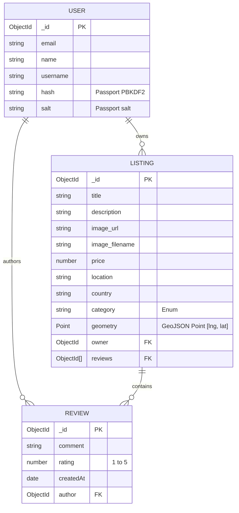

# Wanderlust — Application Architecture & Data Flow Audit

**Project:** WanderLust  
**Audit Phase:** Phase 3  
**Technology Stack:** Node.js (v22.14.0), Express (5.1.0), MongoDB / Mongoose (8.17.0), EJS-Mate, Passport.js, Cloudinary, Mapbox SDK, Google Generative AI  

---

## 1. System Overview & Entry Point

Wanderlust is structured as a classical Model-View-Controller (MVC) server-rendered web application built on top of Express 5.1.

- **Entry Point:** `app.js` initializes the Express application, configures templating engines, connects to MongoDB Atlas, establishes MongoStore session persistence, configures Passport authentication strategies, mounts domain routers, and sets global middleware and error handling.
- **Port Binding:** Listens on `process.env.PORT || 8080` (conditionally invoked when run as main module, enabling seamless automated testing).

---

## 2. Express Middleware Pipeline & Execution Order

Every incoming HTTP request executes through a strictly ordered pipeline:

```
[Incoming HTTP Request]
   │
   ├─► 1. express.urlencoded({ extended: true })  (Parses form submissions)
   ├─► 2. express.json()                         (Parses JSON payloads for API / AI)
   ├─► 3. express.static("public")               (Serves static assets: CSS, JS, images)
   ├─► 4. methodOverride("_method")              (Enables PUT / DELETE verbs via forms)
   ├─► 5. session(sessionOptions)                (Cookie-based session store via connect-mongo)
   ├─► 6. flash()                                (Flash messaging integration)
   ├─► 7. passport.initialize()                  (Initializes Passport authentication)
   ├─► 8. passport.session()                     (Deserializes user from session store)
   ├─► 9. Custom Context Middleware:
   │      - res.locals.success = req.flash("success")
   │      - res.locals.error   = req.flash("error")
   │      - res.locals.currUser = req.user
   │      - res.locals.mapToken = process.env.MAP_TOKEN
   │
   ├─► 10. Route Dispatchers:
   │      - /listings/ai-generate               (Gemini Generative AI endpoint)
   │      - /listings                           (listingsRouter: CRUD, search, filter)
   │      - /listings/:id/reviews               (reviewsRouter: nested review CRUD)
   │      - /                                   (userRouter: auth + index redirects)
   │
   ├─► 11. 404 Catch-All Middleware              (Instantiates ExpressError(404, "Page not found"))
   │
   └─► 12. Global Error Handling Middleware      (Renders listings/error.ejs with status code)
```

---

## 3. MVC Separation & Routing Architecture

The codebase cleanly decouples routing definitions from business controller logic:

```
        ┌─────────────────────────────────────────────────────────┐
        │                     Express Router                      │
        │      (routes/listing.js, review.js, user.js)            │
        └───────────────────────────┬─────────────────────────────┘
                                    │
                                    ▼
        ┌─────────────────────────────────────────────────────────┐
        │                 Middleware Interceptors                 │
        │        (isLoggedIn, isOwner, validateListing)           │
        └───────────────────────────┬─────────────────────────────┘
                                    │
                                    ▼
        ┌─────────────────────────────────────────────────────────┐
        │                       Controllers                       │
        │    (controllers/listing.js, review.js, user.js)         │
        └──────────────┬───────────────────────────┬──────────────┘
                       │                           │
                       ▼                           ▼
        ┌─────────────────────────┐ ┌─────────────────────────────┐
        │     Mongoose Models     │ │         EJS Views           │
        │ (Listing, Review, User) │ │   (views/listings, users)   │
        └─────────────────────────┘ └─────────────────────────────┘
```

1. **Routes (`routes/`):** Define endpoints using `router.route()` chains, injecting authorization middleware (`isLoggedIn`, `isOwner`, `isReviewAuthor`), file upload middleware (`multer`), and schema validators (`validateListing`, `validateReview`) before calling controllers wrapped in `wrapAsync`.
2. **Controllers (`controllers/`):** Pure request/response handlers that interact with Mongoose models, invoke third-party services (Mapbox forward geocoding), and render EJS views or issue redirects.
3. **Models (`models/`):** Define Mongoose schemas, relationships, defaults, and plugins (`passport-local-mongoose`).

---

## 4. Database Architecture & Schema Relationships



### Schema Analysis & Referential Integrity

- **Listing Ownership (`owner`):** Single `ObjectId` referencing `User`. Populated during `showListing` to display host details and gate Edit/Delete controls.
- **Listing Reviews (`reviews`):** Array of `ObjectId` references to `Review`. Populated along with nested `author` during listing view.
- **Cascading Deletion:** When a listing is deleted via `destroyListing`, `Review.deleteMany({ _id: { $in: listing.reviews } })` cascades and deletes all related reviews, preventing orphaned documents.
- **Spatial Geometry (`geometry`):** GeoJSON object with `type: 'Point'` and `coordinates: [Number]`. Stored in standard `[longitude, latitude]` format as returned by Mapbox forward geocoding.

---

## 5. End-to-End Operation Data Flows

### A. Listing Creation Flow
1. User submits multipart form (`title`, `description`, `price`, `location`, `country`, `category`, `listing[image]`).
2. Multer intercepts file upload and pipes the buffer directly to Cloudinary (`WanderLust_DEV` folder). Cloudinary returns secure HTTPS CDN URL and asset filename.
3. `validateListing` validates text fields against Joi `listingSchema`.
4. `createListing` invokes Mapbox forward geocoding service with `req.body.listing.location`.
5. Mapbox returns coordinates; controller handles fallbacks safely if location is ambiguous.
6. Mongoose creates `Listing` with `owner: req.user._id` and saves to MongoDB Atlas.
7. Controller flashes `"New listing was created!"` and redirects to `/listings`.

### B. Review Submission Flow
1. Authenticated user visits `/listings/:id` where listing is owned by another user.
2. User selects 1–5 stars (rendered via Starability checkmark radio buttons) and enters comment.
3. Form POSTs to `/listings/:id/reviews`.
4. `validateReview` validates payload against Joi `reviewSchema` (rating between 1 and 5, non-empty comment).
5. `createReview` creates `Review` with `author: req.user._id`.
6. Review is appended to `listing.reviews` array; both documents are saved.
7. Redirects to `/listings/:id`.

---

## 6. External Service Integrations

1. **MongoDB Atlas:** Multi-region cloud database hosting collections for `listings`, `reviews`, `users`, and `sessions`.
2. **Cloudinary (v2):** Secure cloud image storage and transformations with dynamic CDN URL generation.
3. **Mapbox SDK (`@mapbox/mapbox-sdk`):** Server-side forward geocoding translating address strings to geospatial coordinates.
4. **Mapbox GL JS:** Client-side vector map renderer with interactive pins and popup overlays.
5. **Google Generative AI (`gemini-flash-latest`):** Server-side LLM endpoint drafting catchy short descriptions from user keywords.
